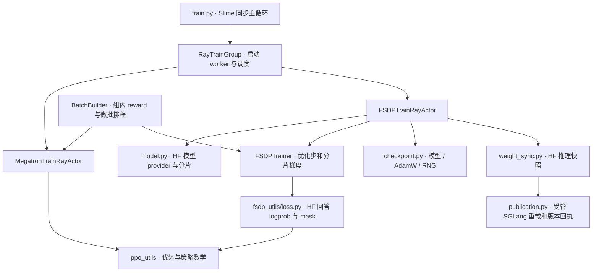

# FSDPTurbo 后端适配

`feat/fsdp2-merge` 以合作分支 `0bc6dc8` 为基础。外层构建遵循 [开发指南](../development.md) 和 [补丁维护规则](../../patches/README.md)，从 `18868a79` 应用 MANIFEST 中的 Slime 补丁。

## 代码职责



合作分支的 Ray actor 注册、可选训练 Python、同步训练和 DCP/数据游标继续使用。FSDP 随实际 world size 分片，基类负责 NPU、WORLD 和 Gloo，训练器在已有 WORLD 上安装 Turbo 的 NPU 委托。训练器通过 Turbo OptimizerFactory 创建选中的优化器，在 FP32 DTensor 主分片上更新。Torch 原生 FSDP2 负责参数与梯度并行。

梯度范数与裁剪使用 FSDPTurbo 的 `compute_grad_norm()` 和 `clip_grad_by_norm()`。Slime 在计算范数前检查梯度是否齐全，在裁剪前检查范数是否有限。Turbo 根据 DTensor 的分片维度选择归约组。

## 模型和拓扑

- **加载已有权重。** `--hf-checkpoint /path/to/model` 读取该目录的 HF 配置和权重。
- **按配置随机初始化。** `--fsdp-random-init --fsdp-model-config /path/to/model.json --seed 1234` 用 HF Auto 类构造模型。在线时将配置命名为 `config.json`，与相同架构和词表的 tokenizer 资产放在一起。SGLang 以 dummy 权重启动，Slime 在 `training_ready()` 前发布并确认实际的 actor 初始权重。该目录可以没有任何预训练权重。
- **模型扩展。** `--fsdp-model-provider package.module.provider` 或原仓的 `--custom-model-provider-path` 选择 FSDP provider。回调签名为 `provider(config, *, checkpoint, dtype, seed)`，返回使用 HF 权重命名与配置的未包裹 decoder-only causal LM，`checkpoint=None` 代表随机初始化。模型若需自定义 HF 配置类，可以在 provider 模块注册该配置。
- **分片扩展。** 默认从模型声明的 `_no_split_modules` 选分片模块。也可通过 `--fsdp-wrap-modules 'model.layers.{*}'` 提供 FSDPTurbo 路径。共享参数保持同一归属。
- **卡数。** 在线例子可通过 `FSDP_TRAIN_DEVICES`、`FSDP_ROLLOUT_DEVICES` 和 `FSDP_DEVICES_PER_ENGINE` 设置训练卡、推理卡和 TP engine 的卡数。按实际 world size 配置 rollout batch、global batch 和 microbatch。在线路径目前为单节点训练和 TP-only SGLang，验收 fixture 自带其数值对照的固定规模。

`config.json` 描述模型结构。HF 目录负责初始权重读取，推理快照写模型配置及 BF16 权重。续训使用 `--save` / `--load` 的 DCP 与数据游标，恢复训练参数、选中优化器的状态、RNG 和进度后，再发布新的 HF 版本。

## 优化器扩展

`fsdp_utils/optimizer.py` 将 Slime 配置与参数组适配到 FSDPTurbo 的 `OptimizerFactory.create()`。工厂可使用 `torch.optim` 中的类型、Turbo 已注册的名称，或自定义构造回调。

| 选项 | 契约 |
| --- | --- |
| `--fsdp-optimizer-type` | 工厂 source 名称，默认 `AdamW`，也可选择 `Adam`、`SGD` 或已注册类型 |
| `--fsdp-optimizer-kwargs` | JSON 对象，传递优化器专用构造参数，例如 SGD 的 momentum。lr、weight decay 与 params 由 Slime 选项和参数组管理 |
| `--fsdp-optimizer-provider` | `constructor(param_groups, **kwargs)`，作为 Turbo 的 `custom_fn`，返回 Torch-compatible Optimizer |
| `--fsdp-optimizer-param-groups` | `function(model, args)`，接收 FSDP2 wrap 后的 HF 根模型，返回参数组及各组的 lr、weight_decay 或优化器专用设置 |

默认参数组包含全部可训练参数，每个参数出现一次。回调可以按模型名称和参数维度组织分组，排除 frozen 参数，并设置不同学习率或 decay。Adam/AdamW 的现有 beta、eps 参数继续映射到构造器，其他类型与自定义 provider 使用自己的 kwargs。当前学习率调度采用 constant。

```bash
--fsdp-optimizer-type Adam --fsdp-adam-beta1 0.9
--fsdp-optimizer-type SGD --fsdp-optimizer-kwargs '{"momentum":0.9}'
--fsdp-optimizer-type MyMuon --fsdp-optimizer-provider my_package.build_muon \
  --fsdp-optimizer-param-groups my_package.muon_parameter_groups
```

Muon 等实现可通过上述回调和工厂注册入口扩展。算法的参数形状和分布式布局要求由对应实现满足。Torch 原生 Muon 只接受二维参数，完整语言模型的 Muon/辅助 optimizer 分组与 DTensor 实跑需要专项适配和验收。

DCP 沿用选中优化器的通用 state_dict，不约束其状态必须包含 Adam moments。checkpoint 记录实际 optimizer class、参数组成员与设置，恢复前核对配置，恢复后核对参数组。已有默认 AdamW checkpoint 保持可读。固定数值验收 fixture 使用默认 AdamW oracle，通用优化器的回归脚本放在独立运行目录。

## 更新与发布

策略用公共 `--advantage-estimator` 选择 `grpo`、`gspo` 或 `cispo`。CISPO 可设 `--eps-clip 1 --eps-clip-high 0.2` 来关闭下界并设置上界。GSPO 的概率比需要一条完整 rollout 的有效 token，分段样本会在 FSDP 更新前报错。默认 old policy 在 `eval()` 和 `no_grad()` 下整轮冻结，随后回到 `train()`，显式恢复并检查 FP32 DTensor 主分片。FSDP loss adapter 复用 Slime 的 advantage 计算及原有 `torch.compile` 策略函数，负责 padded 输入的 logprob、掩码归约与分片梯度累积。

受管权重发布沿用合作分支的流程。每个 rank 参与 DTensor 聚合，rank 0 原子发布 BF16 HF 快照，保留整数等非浮点 buffer 的 dtype。tied 权重按模型的 embedding/head 接口验证。Ray 对所有 engines 暂停、清缓存、重载并确认版本。DCP 续训文件与这些快照各有自己的目录和版本边界。

## 环境和验收

A2 环境使用原仓核心版本 CANN 9.1、Python 3.12、torch 2.10、torch-npu post6、Transformers 5.12.1。按 [FSDPTurbo 回移说明](../../patches/third_party/fsdp-turbo/README.md) 准备 provider。需要隔离训练解释器时，可走 `scripts/install-fsdp-environment.sh`，再传 `--fsdp-python-executable`。

本地回归覆盖两种模型来源、HF 绑权与导出、不同训练和推理卡数的参数接线、三种策略目标的值和梯度，并运行 CPU DCP 续跑对照。卡数接线测试使用 SGLang 参数替身。原仓 A2 镜像、不同 TP 的实际重载和随机模型首次在线发布需要在 NPU 环境验收。
